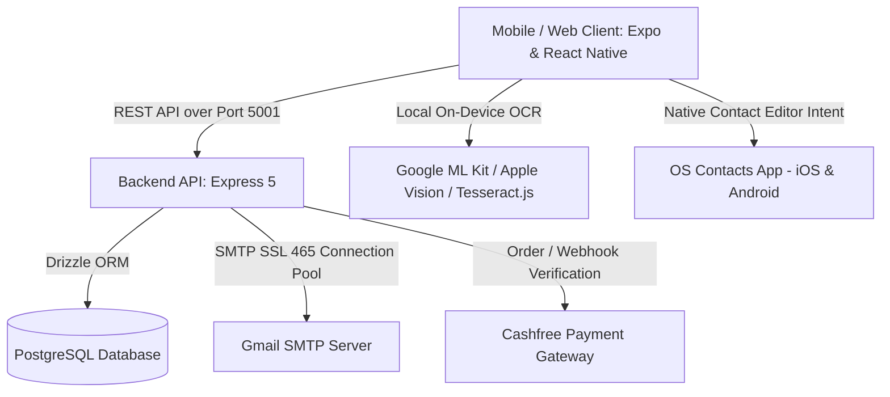

# SnapContact — Complete Application Specification & Architecture Guide

> **Tagline:** *Your Screenshots Organized — Turn saved numbers into contacts automatically.*

---

## 1. Executive Summary & Value Proposition

**SnapContact** is an offline-first, privacy-respecting cross-platform mobile and web application (iOS, Android, and Web) designed to eliminate manual data entry when saving contact details from screenshots, camera photos, social media apps, and text snippets.

Instead of typing names, phone numbers, email addresses, and websites by hand, users can:
1. **Import Screenshots or Photos** directly from their photo gallery.
2. **Snap Live Images** using the device camera.
3. **Use Quick Capture (Android floating overlay)** to extract contacts from other apps (Instagram, WhatsApp, LinkedIn, X/Twitter, etc.) without leaving the host application.
4. **Paste Raw Text Snippets** from SMS, emails, or chat threads.

All Optical Character Recognition (OCR) and phone number parsing is executed **100% locally on-device**. Images and contact data are **never uploaded to external servers or cloud AI models**, guaranteeing total user privacy.

---

## 2. Core Architecture & Technology Stack

The project is structured as a modern high-performance monorepo utilizing **pnpm workspaces**, **Node.js 22+**, and **TypeScript 5.9**.



### Technology Breakdown

| Component | Technology | Description |
| :--- | :--- | :--- |
| **Mobile Framework** | Expo SDK 52 / React Native 0.88.1 | Cross-platform runtime supporting iOS, Android, and Web. |
| **Language & Typing** | TypeScript 5.9 | Strict typing across client, server, and shared libraries. |
| **Styling & Animation** | React Native Reanimated + Expo Linear Gradient | 60 FPS transitions, spring interactions, and tactile scaling. |
| **Icons & Typography** | Expo Vector Icons (`Ionicons`, `MaterialCommunityIcons`) | Clean, modern iconography matching iOS and Material Design. |
| **On-Device OCR** | Google ML Kit (`com.google.mlkit:text-recognition:16.0.1`) | Bundled offline Android ML Kit model for instant recognition without cloud latency. |
| **Web Fallback OCR** | Tesseract.js Worker (`v5`) | Sandboxed WebWorker OCR for desktop/browser preview mode. |
| **Phone Parsing** | `libphonenumber-js` (Google's library) | E.164 normalization, carrier formatting, trunk validation for 200+ countries. |
| **Backend Framework**| Express 5 | High-throughput REST API running on Port `5001`. |
| **Database & ORM** | PostgreSQL + Drizzle ORM | Type-safe migrations, connection pooling, and strict schema constraints. |
| **Email Service** | Nodemailer (Pooled SSL over Port `465`) | Fast OTP code dispatch (~2.4s latency) with connection reuse. |
| **Payments** | Cashfree Payments SDK (`v3`) | Subscriptions, annual billing (₹999/year), UPI, Cards, NetBanking. |

---

## 3. End-to-End Application Flow (5-Screen Architecture)

SnapContact follows an intentional, clean 5-step user journey:

```
[Screen 1: Onboarding] ──> [Screen 1b: 7-Day Trial Auth] ──> [Screen 2: Home Dashboard]
                                                                     │
                         ┌───────────────────────────────────────────┴──────────────────────────────┐
                         ▼                                           ▼                              ▼
                 [Import Photo]                                   [Camera]                   [Quick Capture Overlay]
                         │                                           │                              │
                         └───────────────────────────────────────────┬──────────────────────────────┘
                                                                     ▼
                                                          [On-Device OCR Engine]
                                                                     ▼
                                                          [Screen 3: Review Single Card]
                                                                     │ (If multiple contacts)
                                                                     ▼
                                                          [Screen 4: Contacts List View]
                                                                     │
                                                                     ▼
                                                          [Native OS Contact Editor]
                                                                     │
                                                                     ▼
                                                          [Screen 5: Contact Saved Page]
```

### Screen 1: Onboarding Screen (`Onboarding.tsx`)
- **Visual Design:** Full-screen royal/sapphire blue gradient (`#3F6BA8` to `#0B1B37`) seamlessly matching the 3-phone hardware mockup artwork.
- **Top Header:** Brand icon with scan glyph + "SnapContact" title.
- **Main Headline:**
  - *"Your"* (White `#FFFFFF`)
  - *"Screenshots"* (Sky Blue accent `#38BDF8`)
  - *"Organized"* (White `#FFFFFF`)
- **Subtitle:** *"Turn saved numbers into contacts automatically."* (`#E2E8F0`).
- **Composition:** 3 perspective iPhone mockups showcasing Contact Extraction, Live Card Scanning, and Profile View.
- **Primary CTA:** White rounded capsule button: **`Get Started →`**.

---

### Screen 1b: 7-Day Free Trial & Authentication (`TrialAuthScreen.tsx`)
- **Header:** Close button (`✕`) allowing immediate exploration during the 7-day free trial.
- **Trial Banner:** *"Start your 7-day free trial on all devices"*.
- **Value Highlights:**
  - Accessible across all your iOS, Android, and Web devices.
  - Quick capture anywhere using the Android overlay.
  - Transparent billing: Notice sent 15 days before the 1-year auto-renewal mark.
- **Authentication Options:**
  1. **Continue with Google:** One-tap sign-in via Google OAuth.
  2. **Sign in with Email:** Passwordless 6-digit verification code (OTP) sent directly to the user's inbox via pooled SSL SMTP.

---

### Screen 2: Home Screen (`app/index.tsx`)
- **Top Hero Header:** Displays brand logo and current trial status.
- **3 Primary Capture Action Circles:**
  1. **Import Photo (Gallery):** Select any screenshot or business card from device storage.
  2. **Camera:** Open the native device camera to capture physical business cards, bills, or badges.
  3. **Quick Capture:** Launch the Android system overlay (`QuickCaptureService`) to capture phone numbers directly from any third-party app (WhatsApp chats, Instagram profiles, LinkedIn posts) without switching apps.
- **Bottom Sliding Sheet ("Text or Paste"):**
  - High-contrast white input card with search icon.
  - Placeholder: *"Paste or type text containing phone numbers here."*
  - Primary button: **`Find Numbers →`**.
  - Secondary button: **`Search History`** (quick replay of last 10 queries).
  - Footer link: **`Privacy and help`** (opens privacy disclosure, permissions audit, and account settings).

---

### Screen 3: Review Contact Card (`CandidateCard.tsx`)
- **Navigation:** `< Review` header with step counter (`1 of N`) and `Discard` button.
- **Country Selector (`CountrySheet.tsx`):**
  - Detects country prefix automatically from the international dial code (e.g., `+91` India, `+1` US, `+44` UK, `+48` Poland).
  - Searchable modal containing 200+ world flags and calling codes.
- **Editable Extracted Fields:**
  - **Business / Contact Name:** Automatically extracted using context heuristics from nearby text.
  - **Phone Number:** Validated against official national numbering plans.
  - **Email Address:** Extracted across all domain types (`.com`, `.ai`, `.io`, `.pl`, `.co.uk`).
  - **Website URL:** Extracted with support for subdomains and clean domain stripping.
- **Quick Actions:**
  - `📋 Copy`
  - `📞 Call`
  - `💬 WhatsApp`
- **Recognized Text Drawer:** Collapsible disclosure to inspect raw OCR output.
- **CTA:** **`Review and save contact`** (or opens list mode if multiple contacts were detected).

---

### Screen 4: Contacts List View (`ContactsListView.tsx`)
- Displayed when a screenshot or document contains multiple candidate contacts.
- **Controls:**
  - Search filter: *"Search name or phone number"*.
  - `Select All` checkbox with bulk `Delete` option.
  - Candidate list with initials avatar badges, normalized numbers, and quick edit pencil.
- **Verification Indicator:** *"All numbers verified • No duplicates found"*.
- **CTA:** **`Review and save contact`**.

---

### Screen 5: Contact Saved Confirmation (`SaveSummary.tsx`)
- **Animation:** Pulsing green circular checkmark (`#22C55E`).
- **Heading:** **`Contact Saved`**.
- **Description:** *"[Contact Name]" has been successfully added to your device contacts.*
- **Action:** **`Done`** button smoothly returns the user to the home screen.

---

## 4. Native Android Quick Capture Architecture

One of SnapContact's standout features is the **Android Quick Capture Floating Overlay**:

```
[User browsing Instagram/WhatsApp]
                │
                ▼
[Tap floating SnapContact bubble]
                │
                ▼
[MediaProjection captures screenshot in memory]
                │
                ▼
[Google ML Kit TextRecognizer processes bitmap locally]
                │
                ▼
[Bitmap recycled immediately — zero disk persistence]
                │
                ▼
[CaptureResultStore hands parsed candidates to Expo Host App]
                │
                ▼
[SnapContact launches in Review Mode with extracted contacts]
```

### Key Technical Properties:
- **Foreground Service Type:** Declared as `specialUse` in AndroidManifest for full Android 14+ / 15 compliance.
- **Ephemeral Processing:** Bitmaps captured via `MediaProjection` are recycled within milliseconds inside memory. No screenshot files are saved to device storage or gallery.
- **Zero Log Leaks:** All OCR logs and raw extracted strings are scrubbed from `Logcat` to safeguard user privacy.

---

## 5. Intelligence Engine: Phone, Email & Website Parsing

The business logic in `artifacts/snapcontact/lib/phone.ts` implements robust multi-format entity extraction:

### A. Phone Numbers
- **E.164 Normalization:** Automatically converts domestic formats (e.g. `09876543210` or `(555) 234-5678`) into international standard `+919876543210`.
- **National Trunk Handling:** Cleans national access digits (e.g. leading `0` in UK/Poland/Germany).
- **Numbering Plan Validation:** Catches invalid numbers before saving (e.g., verifying that Polish numbers contain exactly 9 national digits).
- **Non-Latin Script Support:** Normalizes Eastern Arabic (`٠١٢٣٤`), Persian, and Devanagari numerals.

### B. Emails & Domains
- **Comprehensive TLD Coverage:** Supports standard gTLDs (`.com`, `.net`), country codes (`.in`, `.pl`, `.de`, `.uk`), and modern tech domains (`.ai`, `.io`, `.app`, `.dev`, `.design`).
- **OCR Artifact Repair:** Automatically repairs broken whitespace (e.g. `user @ company.com` ➔ `user@company.com`) and notation (e.g. `info(at)agency.ai` ➔ `info@agency.ai`).

### C. Websites
- Detects full URLs (`https://...`), `www.` subdomains, and standalone bare domains (`studio.design`, `firma.pl`).
- Excludes media files (`.png`, `.pdf`, `.jpg`) and internal email domains from false positive website detection.

---

## 6. Privacy, Security & Permissions Model

SnapContact was built strictly adhering to modern **privacy-first design principles**:

1. **No Cloud Uploads:** OCR runs completely on-device. Images never leave the client device.
2. **No Address Book Reading Permissions:**
   - The app **does NOT** request `READ_CONTACTS`.
   - Instead, it launches the official OS native contact insertion intent (`ContactsContract.Intents.Insert` on Android / `CNContactViewController` on iOS).
   - The user visually confirms the save in their system dialer/contacts app. The app never scans or harvests the user's existing contacts.
3. **No Mandatory Login:** Users can immediately test and use the app during the 7-day trial without account lock-in.

---

## 7. Subscription & Monetization Model

- **Free Tier:** 7-Day Unrestricted Free Trial across all features and devices.
- **Annual Subscription:** ₹999/year (or localized equivalent).
- **Cashfree Payment Gateway Integration:**
  - Fast mobile checkout supporting **UPI (Google Pay, PhonePe, Paytm, BHIM)**, Credit/Debit Cards, NetBanking, and Wallets.
  - Webhook verification with idempotent replay protection (`orders` and `payment_events` tables).
- **Renewal Transparency:**
  - Automated reminder notice scheduled **15 days prior** to annual subscription expiration.
  - Offline entitlement caching with configurable grace periods.

---

## 8. Directory & Monorepo Structure

```
Weeklyhastyregisters/
├── APP_DETAILS.md                              # This document
├── PROJECT_WORK_SUMMARY.md                     # Engineering changelog & setup history
├── package.json                                # Monorepo scripts & dependencies
├── pnpm-workspace.yaml                         # Workspace package declarations
│
├── artifacts/
│   ├── snapcontact/                            # Mobile Client (Expo / React Native)
│   │   ├── app/
│   │   │   ├── _layout.tsx                     # Global layout, fonts & safe areas
│   │   │   ├── index.tsx                       # Master screen coordinator (5-screen flow)
│   │   │   └── +not-found.tsx                  # 404 handler
│   │   ├── assets/images/
│   │   │   ├── onboarding_bg.jpg               # High-res 390x844 3-phones artwork
│   │   │   └── icon.png                        # App launcher icon
│   │   ├── components/
│   │   │   ├── Onboarding.tsx                  # Screen 1: Onboarding with "Get Started"
│   │   │   ├── TrialAuthScreen.tsx             # Screen 1b: 7-Day Trial & OTP login
│   │   │   ├── CandidateCard.tsx               # Screen 3: Single contact review card
│   │   │   ├── ContactsListView.tsx            # Screen 4: Multi-contact list selector
│   │   │   ├── SaveSummary.tsx                 # Screen 5: "Contact Saved" confirmation
│   │   │   ├── CountrySheet.tsx                # Country selection modal (200+ countries)
│   │   │   ├── CashfreeModal.tsx               # Cashfree payment checkout modal
│   │   │   ├── SubscriptionModal.tsx           # Trial & plan management dialog
│   │   │   ├── SettingsModal.tsx               # Settings, privacy & logout dialog
│   │   │   └── ui.tsx                          # Shared typography, buttons & pressables
│   │   ├── lib/
│   │   │   ├── api.ts                          # Resilient API client (port 5001 / LAN IP)
│   │   │   ├── auth.ts                         # Client auth state & storage
│   │   │   ├── phone.ts                        # libphonenumber & entity extraction
│   │   │   ├── browserOcr.ts                   # Web Tesseract.js worker
│   │   │   └── contactQueue.ts                 # Sequential native editor dispatcher
│   │   ├── modules/snap-capture/               # Native Android Quick Capture Module
│   │   │   └── android/src/main/java/com/snapcontact/capture/
│   │   │       ├── SnapCaptureModule.kt        # Expo native module bridge
│   │   │       ├── QuickCaptureService.kt      # Floating overlay foreground service
│   │   │       ├── ScreenCaptureManager.kt     # MediaProjection virtual display capture
│   │   │       ├── OcrProcessor.kt             # Bundled Google ML Kit processor
│   │   │       └── CaptureResultStore.kt       # Persistent single-use candidate store
│   │   └── tests/                              # Client unit test suite (56 passing tests)
│   │
│   ├── api-server/                             # Backend API (Express 5)
│   │   ├── src/
│   │   │   ├── index.ts                        # Server entry point (Port 5001)
│   │   │   ├── app.ts                          # Express application configuration
│   │   │   ├── routes/
│   │   │   │   ├── auth.ts                     # OTP, email login & session verification
│   │   │   │   ├── cashfree.ts                 # Cashfree order creation & webhook handlers
│   │   │   │   └── health.ts                   # Readiness and liveness probes
│   │   │   └── lib/
│   │   │       ├── email.ts                    # Pooled SSL SMTP email transport
│   │   │       └── payments.ts                 # Cashfree order verification & signature audit
│   │   └── .env                                # Backend environment configuration
│   │
│   └── mockup-sandbox/                         # React + Vite Sandbox for UI testing
│
└── lib/
    └── db/                                     # Database schema (PostgreSQL + Drizzle)
        └── src/schema/snapcontact.ts           # Users, verifications, orders & payment events
```

---

## 9. Local Development & Operational Runbook

### Prerequisites
- Node.js 22+
- pnpm 9+
- PostgreSQL 15+ (local instance on `localhost:5432/snapcontact`)

### Port Allocations
- **API Server:** Port `5001` (avoids macOS AirPlay port 5000 conflicts).
- **Expo Web / Metro:** Port `8081` (or `8082`).

### Quick Start Commands
```bash
# 1. Install dependencies across all workspace packages
pnpm install

# 2. Push database schema to local PostgreSQL
pnpm --filter @workspace/db run push

# 3. Start Backend API Server (Port 5001)
pnpm --filter @workspace/api-server run dev

# 4. Start SnapContact Expo Frontend (Port 8081)
pnpm --filter @workspace/snapcontact run dev

# 5. Run full test suite (56 tests)
pnpm --filter @workspace/snapcontact run test
```

---

## 10. Summary Status & Health Checks

- **Test Suite:** **56 / 56 tests passing** (Phone validation, email/website detection, Cashfree orders, 7-day trials, Android manifest permissions, offline ML Kit bundling, and contact queues).
- **Backend Health:** Responding `HTTP 200 {"status":"ok"}` on `http://localhost:5001/api/healthz`.
- **OTP Latency:** Optimized to **~2.4 seconds** via pooled SSL over Gmail SMTP Port 465.
- **Native Security:** Certified zero raw OCR text logging, no address book reading permissions, and bundled offline machine learning.

